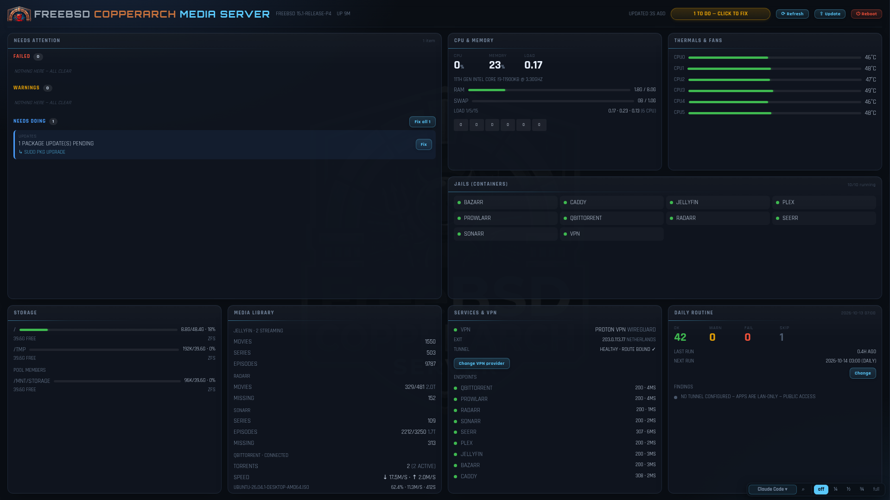
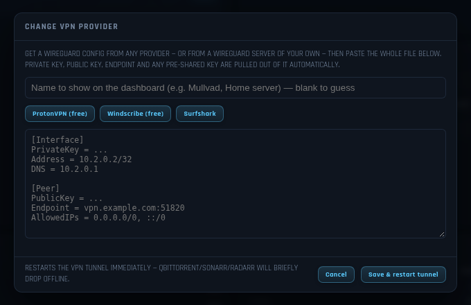

# FreeBSD CopperArch Media Server

**Turn a FreeBSD machine into a home media server that looks after itself.**
One installer sets up the streaming apps, the download apps behind a
WireGuard VPN with a kill-switch, a dashboard that shows the whole machine at
a glance, and a nightly routine that finds and fixes problems while you
sleep.

It is the FreeBSD edition of
[CopperArch-Linux-Media](https://github.com/CopperArch/CopperArch-Linux-Media),
rebuilt on **FreeBSD 15.1** with native tools: jails instead of Docker, pf
instead of a firewall container, ZFS for storage.



## What it does

1. **Asks a few questions**, in a graphical wizard or in the terminal, or
   reads them from a saved profile.
2. **Creates one jail per app** with Bastille and installs each app from
   FreeBSD's own packages: Jellyfin, Plex, Sonarr, Radarr, Prowlarr, Bazarr,
   qBittorrent, Seerr, Caddy, and optionally Nextcloud.
3. **Routes the download apps through a WireGuard tunnel.** A pf kill-switch
   means that if the tunnel drops they are cut off, never exposed on your
   real address.
4. **Gives you a dashboard** with one-click fixes for the things that go wrong.
5. **Keeps itself healthy** with a routine that runs every night.

## Features

**Media and downloads**
- Jellyfin and Plex for streaming; Sonarr, Radarr and Prowlarr to find and
  organise films and series; Bazarr for subtitles; qBittorrent to download;
  Seerr for requests.
- Optional Nextcloud (files and photos) with its own PostgreSQL jail.
- Caddy reverse proxy and optional public access.
- Each app is isolated in its own jail; the media library is mounted in.

**VPN**
- Kernel WireGuard in a dedicated jail. Works with any provider that gives
  you a WireGuard config (Proton VPN, Windscribe, Surfshark, Mullvad, IVPN
  and others) or with a server of your own.
- **Change VPN provider** from the dashboard: paste the new `.conf` file.
- Kill-switch enforced by pf on the host. With no VPN configured, the
  download apps simply stay offline until you add one.

**Dashboard**
- CPU, memory, swap, temperatures and disks, live every 2 seconds.
- Every jail, service, the VPN and the media library, refreshed every
  10 seconds.
- A **Needs attention** list with a **Fix** button next to each problem. Fixes
  come from a fixed whitelist; the page cannot run anything else.
- Update, Reboot and Refresh buttons; a schedule dialog for the nightly run.
- Spots a newly plugged-in drive and offers to add it to the storage pool.
- Only reachable from the machine itself (loopback).

**Self-healing**
- Nightly: ZFS pool and disk health, stopped jails and services, the VPN
  tunnel, package updates with a ZFS snapshot taken first, clean-up of
  old downloads and caches.
- The installer is safe to run again: on a drifted machine it repairs what
  changed and leaves the rest alone.

**Three ways to install**
- A bootable ISO that installs FreeBSD, KDE Plasma and the media server.
- A first-boot script for a fresh FreeBSD install (adds KDE Plasma and
  Bastille), then the installer.
- The installer on its own, with `--dry-run` to preview and a saved profile
  to reproduce a machine.

**Optional local AI**
- Off by default. Installs Ollama with an open-weights model sized to the
  machine's RAM and adds chat panes to the dashboard. Free and offline.

## Screenshots



The screenshots use a demonstration machine: host name, addresses and
downloads are made up.

## Related projects

- [CopperArch-Linux-Media](https://github.com/CopperArch/CopperArch-Linux-Media):
  the same server on Linux, with Docker.
- [CopperBSD](https://github.com/CopperArch/CopperBSD): a FreeBSD
  distribution with this media server built in and a native dashboard.

## How it differs from the Linux edition

FreeBSD has no Docker, so this is not a reskin: the whole runtime is
different. What carries over is the design: a profile-driven installer that
asks before each change and can be re-run safely, plus a dashboard and a
nightly routine that keep the machine healthy.

## The port, in one table

| Concern | Linux edition | FreeBSD edition |
|---|---|---|
| Containers | Docker + Compose | **Bastille jails** (POSIX sh, zero deps; the 2026 consensus) |
| Media apps | linuxserver.io images | **native pkg** (`jellyfin`, `plexmediaserver-plexpass`, `sonarr`, `radarr`, `prowlarr`, `bazarr`, `qbittorrent-nox`) — all in the official ports tree, one app per jail |
| Service mgmt | systemd units | **rc.d** (`service`, `sysrc`) |
| VPN | gluetun container | **kernel WireGuard** (`if_wg`) in a `vpn` jail |
| Kill-switch | gluetun `FIREWALL_*` | **pf** ruleset — drops all egress that isn't the tunnel |
| "route through VPN" | `network_mode: service:gluetun` | confined jails default-route through the `vpn` jail; pf leaves no other path |
| Firewall | ufw / firewalld | **pf** |
| Reverse proxy | Caddy container | **Caddy** (native pkg) |
| Photos/files (Immich) | Immich containers (no FreeBSD build) | **Nextcloud** native — `nextcloud-php83` + php-fpm + PostgreSQL jail + Photos/Memories |
| Volumes | compose `volumes:` | **nullfs** mounts (`bastille mount`) |
| Storage/health | mdadm + SMART | **ZFS** (`zpool status`) + SMART |
| Updates | `apt/dnf/pacman` | **pkg** + `freebsd-update`, with ZFS-snapshot rollback |
| OS installer | (n/a — app only) | **bsdinstall** (scripted `installerconfig`) + first-boot KDE build |
| Desktop | your existing session | **KDE Plasma 6** on X11 via SDDM |
| Local AI (opt-in) | Ollama official installer + systemd user unit | **`pkg install ollama`** (CPU + Vulkan) + its rc.d service; same GLM model choice (`glm-4.7-flash` on ≥24 GB RAM, else `glm4:9b`), off unless `use_local_glm: true` |

## Why base FreeBSD + KDE rather than GhostBSD

You asked for "the best desktop FreeBSD" with KDE. GhostBSD is the flagship
desktop FreeBSD, but it ships MATE/XFCE and its KDE story isn't first-class.
The FreeBSD KDE team targets **upstream FreeBSD** directly: the `kde6`
meta-package is Plasma 6 + Frameworks + SDDM, installed straight from pkg. So
the cleanest KDE-on-FreeBSD is base **FreeBSD 15.1-RELEASE** (which already
ships `bsdinstall`, satisfying "has an installer") plus `kde6`. That also keeps
you on the same upstream you built CopperArch BSD on, and the dashboard's
below-layer KWin window rule ports 1:1 because Plasma uses the same KWin.

X11 is the default session here: Plasma Wayland on FreeBSD is close but not yet
the safe daily-driver in 2026 (SDDM/Wayland quirks, NVIDIA still experimental).
Flip to Wayland by editing `/usr/local/etc/sddm.conf.d/session.conf`.

## Three ways in

**1 — Full ISO: the one-command bare-metal path.** One build, one USB stick,
one machine — everything else is automatic until the wizard needs you:

```sh
./build-iso.sh 15.1-RELEASE      # run as root on a FreeBSD host; emits CopperArch-Media-*.iso
dd if=CopperArch-Media-*.iso of=/dev/daX bs=4M conv=sync   # USB stick (check the device!)
```

Boot the target machine from the stick and it will:

1. pick its own boot disk at install time — internal disks preferred, the
   USB stick itself always excluded (the boot media is identified via its
   iso9660 volume label through `glabel`), two internal disks get a
   **mirrored** ZFS root, one disk a plain stripe;
2. install the base system unattended and reboot;
3. build KDE Plasma 6 + Bastille on first boot, detecting the real GPU by
   PCI vendor ID (Intel HD/Iris/**Arc** → `i915kms`, AMD/ATI → `amdgpu`,
   NVIDIA → `nvidia-drm-kmod`; virtual/BMC display hardware is skipped);
4. ask for the root and `copper` passwords, then start the **setup wizard on
   the console** — app logins, VPN WireGuard keys, dynamic-DNS / public
   access — and build the whole stack (jails, VPN tunnel + kill-switch,
   Nextcloud, dashboard, nightly self-heal) from your answers.

The wizard is Ctrl-C-safe: rebooting resumes it. When it finishes, the box
reboots into the finished desktop.

**2 — First-boot on an existing base install.** On a fresh FreeBSD 15.1 box:
```sh
sh bootstrap/firstboot-kde.sh    # KDE Plasma 6 + SDDM + drm-kmod + Bastille
```

**3 — The stack installer** (once KDE + prereqs exist):
```sh
python3.11 install.py --cli                         # interactive wizard
python3.11 install.py --cli --profile profiles/example.yaml
python3.11 install.py --cli --profile my.yaml --dry-run   # change nothing
./rebuild my.yaml                                   # idempotent re-apply / self-heal on demand
```
Every system-changing step shows an explicit **accept** prompt, exactly like
the Linux edition. Re-running is safe: existing jails are detected, rc knobs
re-asserted, the kill-switch and routine re-rendered.

## The VPN, done the FreeBSD way

There is no gluetun. Instead:

1. A `vpn` jail loads kernel WireGuard (`if_wg`) and brings up `wg0` from
   `vpn/wg0.conf` (rendered from your provider's keys in the profile).
2. `qbittorrent`, `sonarr`, `radarr` are VNET jails whose default route is
   the `vpn` jail's own IP — their traffic only ever enters the tunnel.
3. `vpn/pf-killswitch.conf` is appended to the **host's** `/etc/pf.conf`:
   pf cannot run inside any jail (VNET included — `pfctl` fails with
   "DIOCADDRULE: Operation not permitted"), so the enforcement point is
   the host. The rule is a `block drop quick` on the vpn jail's own epair
   leg (`e0a_vpn`), dropping any confined jail's packet to anywhere except
   the vpn jail itself. If the tunnel drops, that traffic no longer enters
   `wg0` and the rule drops it — **no fallback to your real IP**, ever.

The nightly routine checks the tunnel from *inside* the jail (compares exit IP
to the host WAN IP) rather than trusting a wrapper healthcheck — the same
lesson the Linux edition learned when gluetun reported "healthy" while OpenVPN
looped on auth.

### Any provider, or your own server

The tunnel is plain WireGuard, so it takes a config from **any** provider that
offers one (Proton VPN, Windscribe, Surfshark, Mullvad, IVPN, …) and equally a
**WireGuard server you run yourself** — fill in `wg_private_key`,
`wg_peer_public_key`, `wg_endpoint` (and `wg_preshared_key` if your server uses
one) in the profile, or answer the installer's prompts. To switch later, click
**Change VPN provider** on the dashboard and paste the whole `.conf` file.

The dashboard's VPN card names the VPN that is active. Set `vpn_provider` in
the profile (or type a name in the Change VPN provider dialog) to choose the
label — "Home server", say; left blank it is recognised from the endpoint, or
shown as "Custom VPN".

## Self-healing (three layers, ported)

1. **rc.d** — services run under `service`/`sysrc`; jails restart on boot.
2. **Dashboard repairs** — the loopback web dashboard exposes the same closed
   whitelist of one-click fixes; the collector's data source changes from
   `docker ps` to `bastille list -a` / `jls`. A running repair or update can
   be stopped with **Cancel** (two clicks, since interrupting an upgrade can
   leave it half-applied); it stops the whole command and skips anything
   still queued.
3. **Nightly `daily-routine.sh` (03:00)** — POSIX sh: checks rc services, ZFS
   pool health, SMART, jail liveness, VPN tunnel reality + up-to-3 restarts,
   re-asserts the pf kill-switch, then `pkg upgrade` per jail behind a ZFS
   snapshot with **verify + auto-rollback**, host `pkg` + `freebsd-update`, and
   log pruning. It also moves TV episodes that landed in the movies folder
   (and movies in the TV folder) to the right library
   (`media-library-sort.py`), removes duplicate movies/episodes keeping the
   best copy (`jellyfin-duplicates.py` — **deletes files**, so it stays off
   until you create a Jellyfin API key in `~/.dbmedia/jellyfin-api-key`; run
   it without `--apply` to preview), and `media-library-health.py` keeps a Jellyfin
   collection for every movie franchise with 2+ films (unidentified movies
   are matched only when TMDB and an independent IMDb search agree), keeps
   Plex's automatic collections on, applies hand-made groupings from
   `~/.config/media-library/manual-collections.json`, and fetches every
   poster in both apps, re-fetching broken ones. Don't install Jellyfin's
   "TMDb Box Sets" plugin alongside it — it deletes collections it didn't
   build.

## Repository layout

```
install.py                 # entry point (CLI; tkinter GUI mirrors the Linux one)
rebuild                    # idempotent re-apply from a profile (CopperArch-style)
build-iso.sh               # bake an unattended KDE install ISO
lib/
  platform.py              # THE PORT: pkg / bastille / rc.d / pf helpers
  steps.py                 # ordered, accept-gated steps (reads stack.yaml)
  profile.py               # profile schema (WireGuard fields, not gluetun creds)
  render.py  util.py       # reused verbatim from the Linux edition
stacks/
  stack.yaml               # the whole server as jails — replaces both compose files
vpn/
  wg0.conf.tmpl            # WireGuard tunnel (gluetun replacement)
  pf-killswitch.conf.tmpl  # leak-proof pf ruleset
templates/
  daily-routine.sh         # ported nightly self-heal
  dashboard/               # loopback dashboard (collector retargeted to jls)
bootstrap/
  installerconfig          # scripted bsdinstall (ZFS root)
  firstboot-kde.sh         # fresh base -> KDE Plasma 6 + SDDM + Bastille
profiles/example.yaml      # fill-in template (secrets blank, chmod 600)
```

## Honest caveats / things to confirm on your hardware

- **Dashboard** is fully ported (`templates/dashboard/`): collector, loopback
  repair server, KWin rule, cron/`daemon(8)` supervision and the page itself.
  The collector emits the same `status.json` schema, so the page is unchanged
  bar the VPN panel relabel (gluetun→tunnel) and repair tooltips keyed to the
  FreeBSD fix ids, and the AI panes (Claude Code, opencode, local Ollama,
  DeepSeek/Ox Alpha/Minimax free-tier and paid ChatGPT/Gemini/Hy4) are at
  full parity, with `ai-panes-check.py` refreshing model slugs + live
  pricing nightly. Fill `media-keys.env` (per-app API keys) and
  `deepseek.env` (one OpenRouter key) after first run to light everything up.
- **rc knob names.** A few ports name their `_enable` knob differently from the
  app (Plex is the classic case). They're all centralised in
  `Platform.RC` / `stack.yaml`; after install, `pkg info -D <pkg>` prints the
  port's pkg-message with the exact knob. Confirm and adjust in one place.
- **`jellyseerr`** may not always be a first-class port; if `pkg install
  jellyseerr` misses, it falls back to a Node build (`www/node`) — or run Seerr
  in a Linux jail if you prefer parity with the compose version.
- **GPU module.** `firstboot-kde.sh` auto-loads `amdgpu` (your RDNA work) or
  `i915kms`. NVIDIA on FreeBSD is the rough edge — the `nvidia-drm` kmod works
  for display but hardware transcode in Jellyfin/Plex is far less mature than
  VAAPI on AMD/Intel. If this box has an NVIDIA GPU, budget time there.
- **Nextcloud** ships in the default stack as the Immich replacement (Immich
  has no FreeBSD build): a `nextcloud-db` jail (PostgreSQL) plus a `nextcloud`
  jail (php-fpm + in-jail Caddy + redis), fronted by the reverse-proxy jail,
  with the Photos/Memories/Recognize apps giving the phone-photo-backup +
  timeline Immich provided. Toggle with `use_nextcloud` in the profile.
- **Kasm-Chrome** from the Linux edition isn't ported (Docker-only).
- **Wayland.** X11 is the default for the reasons above; the desktop and the
  dashboard's KWin rule are tested against the X11 session.

## License

MIT — same as the upstream Linux edition.
